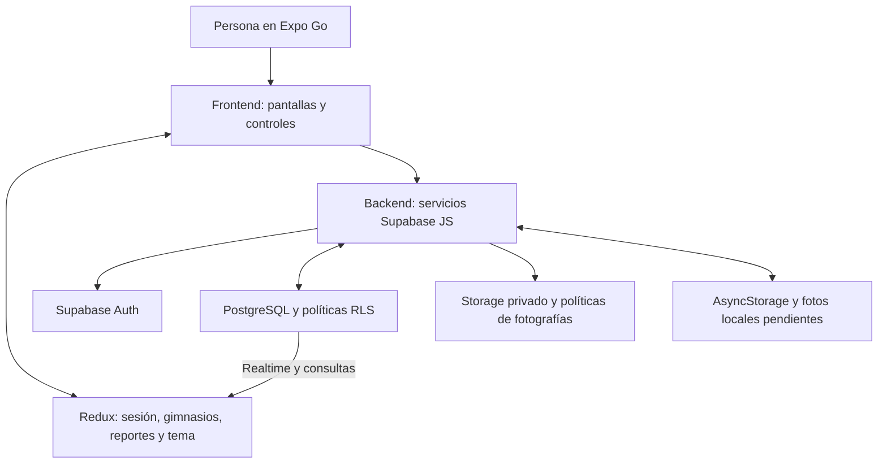

# 1. Consolidación de Visión del Producto, Problema y Estado del Arte.

FitCrew busca ayudar a decidir cuándo acudir a un gimnasio mediante reportes voluntarios de ocupación. El usuario consulta información publicada por otros asistentes y puede compartir un nivel acompañado de una fotografía. El producto se limita inicialmente a dos o tres establecimientos piloto registrados en PostgreSQL. La comunidad aporta la información; el sistema no cuenta personas, no interpreta imágenes ni garantiza el estado presente del establecimiento.

El problema abordado es la incertidumbre sobre la ocupación antes de entrenar. Un dato sin fecha podría inducir una decisión equivocada, de modo que el diseño concede tanta importancia a la antigüedad como al nivel publicado. Si no hay reportes, se informa ausencia de información. Si el último supera una hora o no tiene fecha confirmada, se marca desactualizado y se advierte que la ocupación actual no está disponible. Ningún estado se inventa para llenar una pantalla.

El mecanismo elegido es el reporte colaborativo manual. Frente a alternativas como sensores, torniquetes o reconocimiento de personas, permite mantener el alcance académico y explicar el flujo de datos sin hardware adicional. Esta comparación describe decisiones de alcance, no constituye una investigación empírica de competidores. No se recibieron estudios de mercado, resultados de entrevistas ni referencias específicas de las fases previas; por ello no se atribuyen conclusiones de investigación que no se hayan comprobado.

La actividad social se restringe a un grupo privado con invitación y check-ins. Su finalidad es compartir presencia declarada con amigos, sin chat, seguimiento público ni geolocalización. El check-in no comprueba físicamente que una persona esté en el lugar: registra su declaración autenticada. Los reportes de ocupación y sus fotos pueden ser consultados por cuentas autenticadas; la actividad del grupo exige pertenencia a ese grupo.

Se tomó como especificación el texto adjunto del usuario y su instrucción posterior de migración a Supabase. El usuario confirmó que el profesor no exige Firebase. Los pilotos elegidos son Smart Fit - Central Park Chía, Bodytech Plaza Mayor Chía y Athletic Gym Chía, con direcciones aportadas por el usuario. La carpeta inicial estaba vacía y no contenía la propuesta original, rúbrica oficial de Fase 3 ni compromisos de Fase 2. Esta limitación impide afirmar trazabilidad completa con los documentos originales. Se incluyeron las funciones enumeradas y una cola local limitada como interpretación conservadora del compromiso de reportes pendientes. Cuando se disponga de los PDF, deberán contrastarse funcionalidades y mejoras de accesibilidad antes de declarar la entrega académica aprobada.

El alcance excluye pagos, panel administrativo, notificaciones push, IA, mapas, predicciones, recompensas y sensores. Un procedimiento manual de carga de gimnasios sustituye la necesidad de administrar establecimientos desde el móvil. El historial y los resúmenes describen reportes existentes y no prometen disponibilidad futura.

# 2. Arquitectura de Software Móvil e Implementación Técnica.

La estructura tiene dos carpetas principales solicitadas por el usuario. `frontend/` contiene Expo Router, pantallas, componentes StyleSheet, hooks y estado de interfaz. `backend/` reúne servicios Supabase, modelos, validaciones, cálculos y SQL. Los servicios JavaScript se ejecutan dentro del cliente Expo; las políticas RLS se ejecutan en PostgreSQL. Separar carpetas facilita localizar responsabilidades, pero no convierte el código del cliente en un entorno confiable. Toda autorización se comprueba en el servicio remoto.

La navegación incluye login, registro, cuatro pestañas y detalle por identificador. El layout raíz observa Authentication y protege las rutas con `Stack.Protected`. Al cerrar sesión se eliminan las suscripciones y se reinician los datos globales de gimnasios. Los servicios no importan Redux: reciben datos tipados y devuelven promesas o funciones de cancelación. Las pantallas controlan interacción y mensajes; los componentes reutilizables concentran las propiedades visuales y accesibles.

`Screen` proporciona desplazamiento, área segura y ajuste por teclado. `Field` combina etiqueta y entrada; `Button` unifica objetivos táctiles y estados; `Notice` comunica errores y confirmaciones; `Occupancy` combina símbolo y texto; `ReportPhoto` resuelve referencias de Storage y maneja fallos de imagen. `GymPicker` muestra los establecimientos provenientes del estado global, nunca un catálogo local hardcodeado.

Redux Toolkit maneja tres slices: autenticación con perfil y disponibilidad de sesión; gimnasios con registros, reportes por ID y errores; preferencias con tema. Los hooks están tipados con RootState y AppDispatch. Los objetos User de Supabase y timestamps ISO se convierten a valores serializables. Los formularios, cámara, grupo y operaciones pendientes pertenecen al estado local de sus pantallas. Así se evita convertir toda variable de una pantalla en estado global.

El modelo es deliberadamente pequeño y utiliza permisos explícitos además de RLS:

| Ubicación | Datos | Acceso |
|---|---|---|
| Supabase Auth | id, email, user_metadata.name | Cuenta autenticada |
| gyms | id, name, address | Lectura autenticada; carga administrativa |
| reports | id, gym_id, user_id, level, photo_path, created_at | Lectura autenticada; creación del propio autor con foto existente |
| Storage report-photos | uid/id.jpg, JPEG menor a 5 MiB | Bucket privado; creación propia, lectura autenticada mediante URL firmada |
| profiles | id, group_id | Lectura de la propia cuenta; escritura sólo desde RPC |
| groups | id UUID, name, owner_id, members | Lectura de integrantes; cambio de membresía sólo desde RPC |
| checkins | id, group_id, user_id, name, gym_id, created_at | Lectura de integrantes y creación del propio autor |

Los servicios convierten los campos snake_case de PostgreSQL al camelCase de los modelos de pantalla. El ID del reporte es un UUID generado una vez en el móvil. La publicación verifica la sesión, conserva la imagen durable, lee sus bytes como ArrayBuffer y sube un JPEG con upsert desactivado. Después inserta la fila, sin aportar una fecha de cliente. PostgreSQL asigna created_at y el rol authenticated no tiene permiso de escribir esa columna. La política exige que la imagen ya exista y que su ruta coincida con el UID e ID del reporte.

El reintento consulta primero ese ID. Si está confirmado y corresponde al mismo usuario y gimnasio, no vuelve a publicar. Si la fotografía llegó antes de un fallo de escritura, el conflicto de Storage permite reutilizarla. Los conflictos simultáneos de ID se contrastan con la fila confirmada. No hay permisos de UPDATE o DELETE para reportes, ni políticas de sobrescritura o borrado de fotos para el cliente. Las URLs de descarga se firman durante una hora y no convierten la foto en información secreta frente a quien reciba el enlace.

La cola local se limita a cinco pendientes por cuenta y dispositivo. Guarda metadatos en AsyncStorage y fotos en el directorio documental nativo. El reintento es manual para mantener una implementación comprensible. Un timeout limita la espera visible, pero no cancela una operación Supabase enviada; el ID estable permite reconciliar un éxito tardío. Borrar un pendiente local no equivale a retirar un reporte remoto ya confirmado. Las fotos antiguas deben descartarse: la fecha pública representa publicación, no captura. No hay sincronización automática de tareas en segundo plano.

La consulta de reportes usa PostgreSQL con filtro por gimnasio, orden descendente y límite de 100. Realtime avisa de cambios y dispara una consulta nueva bajo RLS; también hay recuperación al activar la app y cada treinta segundos. El helper cancela canales, eventos y temporizadores al salir y no entrega resultados de consultas ya canceladas. El detalle muestra el último reporte y el historial en tandas de diez para no cargar todas las fotografías a la vez.

El promedio asigna 0/1/2 a Vacío/Medio/Lleno y redondea por tres franjas colombianas: 06–12, 12–18 y 18–06, UTC−5. Una franja sin muestras indica «Sin datos». El resumen describe hasta las últimas cien muestras; no es una predicción ni una medida de aforo calculada automáticamente.

El grupo utiliza su UUID como invitación portadora. RLS sólo deja consultar las filas de grupos propios y sus check-ins. Las funciones SQL create_group y join_group cambian el grupo y el perfil en una transacción, con identidad tomada de auth.uid, filas bloqueadas para concurrencia y máximo veinte integrantes. Cada usuario tiene un grupo activo; no se permite cambiarlo desde el cliente. Estas dos funciones SECURITY DEFINER tienen search_path fijo y ejecución restringida a authenticated. El MVP no implementa expulsión, cambio de grupo ni revocación de invitaciones.

La migración backend/supabase/migrations/001_fitcrew.sql crea tablas, grants, RLS, índices, funciones, bucket privado y publicación Realtime. Puede reejecutarse sin borrar filas. La carga seed-gyms.sql contiene los tres gimnasios proporcionados por el usuario y no añade reportes. El usuario ejecutó el SQL en su proyecto y mostró una captura de éxito; una consulta pública posterior detectó gyms y verificó acceso anónimo bloqueado. Falta demostrar el flujo autenticado móvil completo.

Las variables públicas URL y Publishable key están en frontend/.env.example; el checkout recibió los valores del usuario en el archivo ignorado frontend/.env. El cliente no utiliza contraseñas administrativas ni claves service_role, y rechaza claves de rol administrativo. Supabase Auth conserva la sesión con AsyncStorage y renueva tokens al estar activa la app. Si el registro requiere confirmar correo, se muestra el aviso correspondiente y no se crea una sesión ficticia. Después de confirmar se vuelve manualmente a iniciar sesión; no se implementó callback automático desde el enlace de correo.

# 3. Implementación y Auditoría de Accesibilidad Móvil.

La implementación atiende lectores de pantalla, legibilidad, tamaños táctiles y retroalimentación. Las propiedades nativas se concentran en componentes pequeños para que las pantallas compartan el mismo comportamiento. `Button` expone role, label, hint cuando aporta información y state con disabled, busy y selected. `Field` tiene etiqueta explícita y conserva el comportamiento nativo de entrada. `Notice` usa rol de alerta para errores y región de anuncio polite. Las fotografías tienen descripciones y se marcan accesibles.

Los títulos utilizan rol header y el orden de elementos sigue el flujo de interacción. Las tarjetas con controles no se agrupan en un único elemento accesible, porque ello puede esconder sus acciones. Los iconos de pestañas son decorativos y sus nombres los proporciona el navegador. No se han añadido gestos personalizados: todos los controles se activan con una pulsación.

El cuerpo usa tamaño 17 y altura de línea 26; los títulos 30/38. No se desactiva el escalado del sistema ni se aplican alturas fijas a contenedores de texto. Las pantallas se desplazan y permiten el teclado. Los botones tienen altura mínima de 50 unidades y las pestañas de 48, superando los mínimos pedidos en código. La adaptación de la barra inferior a ampliaciones extremas necesita comprobación visual en dispositivos.

Las paletas separan fondo, superficie, texto, texto secundario, acción y error. Las variantes clara y oscura se seleccionan desde Perfil o siguen el dispositivo; la preferencia se conserva localmente. Los niveles siempre muestran Vacío, Medio o Lleno junto a un símbolo, de modo que el color no es la única señal. El cálculo de contraste sRGB se conserva como verificación reproducible; no sustituye inspección de estados reales, foco y contenido superpuesto.

| Mejora | Componente y archivo | Verificación | Resultado |
|---|---|---|---|
| Etiquetas y roles | Field / Button, frontend/src/components/ui.tsx | Consultas RNTL por label y role | Ver ejecución en verificacion.md |
| Errores perceptibles | Notice, mismo archivo | RNTL por alert | Automatizado; anuncio móvil pendiente |
| Ocupación sin depender del color | Occupancy, mismo archivo | Texto e icono en prueba | Ver ejecución |
| Estados accesibles | Button, mismo archivo | disabled y busy | Ver ejecución; selección en lector pendiente |
| Fotografías descritas | frontend/src/components/ReportPhoto.tsx | Inspección de label/accessible | Implementado; lector pendiente |
| Tema y tipografía | frontend/src/constants/theme.ts y ui.tsx | Contraste y fuente del sistema | Cálculo disponible; dispositivo pendiente |
| Objetivos táctiles | ui.tsx y app/(tabs)/_layout.tsx | Inspección de dimensiones mínimas | Implementado; medición pendiente |
| Orden de lectura | Screen y pantallas | Recorrido TalkBack/VoiceOver | Pendiente |

La matriz extendida está en `docs/accesibilidad.md`. No se afirma conformidad WCAG AA ni implementación completa de mejoras de Fase 2 sin documentos y auditoría móvil. La evidencia actual distingue propiedades presentes, pruebas automatizadas y comprobaciones todavía pendientes.

# 4. Pruebas Funcionales, Rendimiento y Validación de Usuario.

La estrategia combina comprobación estática, pruebas de servicios con mocks, componentes con React Native Testing Library y políticas RLS en PostgreSQL embebido local. Los mocks no se importan desde el código de producción. Se ejecutaron 73 pruebas Jest y siete de SQL, sin fallos; estos resultados no incluyen una prueba en teléfono. La documentación de ejecución se registra en `docs/verificacion.md`, que es la fuente de resultados reales y limitaciones del entorno. Los comandos reproducibles figuran en README; las pruebas de seguridad usan PostgreSQL embebido aislado del proyecto remoto.

Las pruebas de autenticación comprueban correo normalizado, validación antes de red, registro del nombre y propagación de credenciales incorrectas. Las de ocupación verifican búsqueda con acentos, frontera de 60 minutos, ausencia de fecha y promedio por horario colombiano. Las de publicación comprueban orden foto-documento, rechazo de datos incompletos, cuenta incorrecta, fallos de subida/escritura e idempotencia del reintento. No prueban que un dispositivo físico pueda capturar una foto: esa responsabilidad exige pruebas manuales.

Las pruebas de interfaz verifican etiquetas, roles, estados y mínimos táctiles. Se añadieron recorridos de navegación real con servicios mockeados: acceso, búsqueda, detalle y cierre de sesión con limpieza de Redux. También se prueban estados de carga/error/ausencia de reportes, captura con cámara mock, permisos denegados, pérdida de foco, confirmación y conservación del pendiente ante fallos. Esto demuestra la presencia y ciertos efectos de propiedades accesibles; no demuestra el comportamiento exacto de TalkBack o VoiceOver. Las pruebas SQL incluyen lectura sin sesión, escritura de gimnasios, privacidad del grupo, incorporación propia por RPC, suplantación de autor, cupo, inmutabilidad y políticas de rutas de fotografías. El fixture reproduce auth.uid y el esquema mínimo de Storage; no sustituye los servicios Supabase alojados.

No se han realizado pruebas con usuarios ni encuestas, no se han registrado métricas de rendimiento móvil y no se ha validado todavía el servicio productivo. El proyecto Supabase ya tiene URL y clave pública configuradas y el usuario ejecutó el SQL; la comprobación alojada valida conectividad, acceso anónimo bloqueado y rechazo de credenciales incorrectas con HTTP 400 e invalid_credentials, sin crear usuarios ni enviar correos. Todavía falta registrar una cuenta y comprobar cámara, bucket y dos dispositivos conectados. Generar un bundle o pasar Jest no satisface esos criterios de extremo a extremo.

El plan presencial en `docs/pruebas-manuales.md` requiere registrar dispositivo, sistema y versiones. Incluye cámara denegada y concedida, publicación observada desde una segunda cuenta, pérdida de conexión, reinicio con pendientes, cambio de cuenta, navegación atrás, privacidad social, temas y ampliación tipográfica. Cada evidencia deberá acompañarse del resultado observado; no basta una captura de pantalla de código.

En rendimiento se limita el historial remoto a 100 registros por gimnasio piloto, se comprimen las fotografías y se liberan listeners al salir. Estas decisiones acotan trabajo, pero no prueban un umbral de latencia ni consumo. La revisión futura deberá medir arranque y carga bajo una red conocida, repetir mediciones y comprobar uso de memoria al recorrer historial. No se atribuyen resultados numéricos a optimizaciones sin medición.

# 5. Conclusiones, Limitaciones y Trabajo Futuro.

Se desarrolló una base académica con responsabilidades localizables y servicios conectados a Supabase. Las funciones abarcan acceso, gimnasios, fotos de ocupación, historial, resumen, grupo privado y pendientes acotados. La estructura en frontend/backend facilita explicar dónde se renderiza, dónde se transforma información y dónde se autorizan operaciones. La guía `docs/guia-defensa.md` explica el recorrido del código y `docs/defensa-tecnica.md` resume entradas, estado, errores y accesibilidad por módulo para facilitar cambios durante la sustentación.

La entrega aún depende de configuración y evidencia externa. Deben aportarse los documentos originales, verificar las políticas con sesiones reales y probar el flujo completo en Expo Go sobre un teléfono. La carga de los tres gimnasios ya fue confirmada por el usuario. También falta validar ambos lectores de pantalla y recopilar resultados de uso. ADB no detectó ningún dispositivo conectado durante esta revisión. El registro de pruebas automáticas no autoriza afirmar que todos los criterios académicos se han cumplido.

Las limitaciones funcionales son explícitas: invitaciones sin revocación, cola manual sin sincronización de fondo, posibles fotos huérfanas ante fallos parciales y resumen limitado a las últimas muestras. Los datos dependen de aportes voluntarios y su veracidad no se verifica automáticamente. Los enlaces firmados de fotografías permiten su consulta a quien los reciba durante su vigencia; los check-ins privados se consultan en PostgreSQL bajo RLS por membresía.

El trabajo pendiente prioritario consiste en contrastar la rúbrica, completar el entorno, ejecutar la lista manual y corregir hallazgos reales. Mejoras futuras sólo se justificarán por evidencia o compromisos oficiales. No se propone ampliar a IA, pagos o funciones comerciales para cubrir vacíos de validación. Se preserva el historial real del repositorio; no se fabrican commits ni participación del equipo.

Referencias técnicas: documentación oficial de [Supabase Auth y React Native](https://supabase.com/docs/guides/auth/quickstarts/react-native), [Expo Go y SDK](https://docs.expo.dev/troubleshooting/expo-go-version-mismatch/), [Supabase Storage](https://supabase.com/docs/reference/javascript/storage-from-upload), [políticas RLS](https://supabase.com/docs/guides/database/postgres/row-level-security) y [accesibilidad React Native](https://reactnative.dev/docs/accessibility). Extensión orientativa: 5–8 páginas según maquetación; este Markdown no fija paginación ni se ha presentado como un PDF de extensión comprobada.
